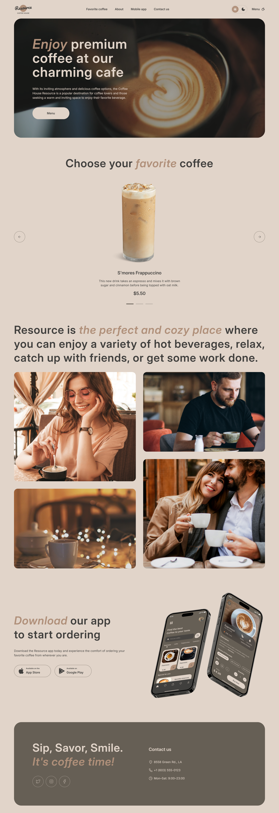
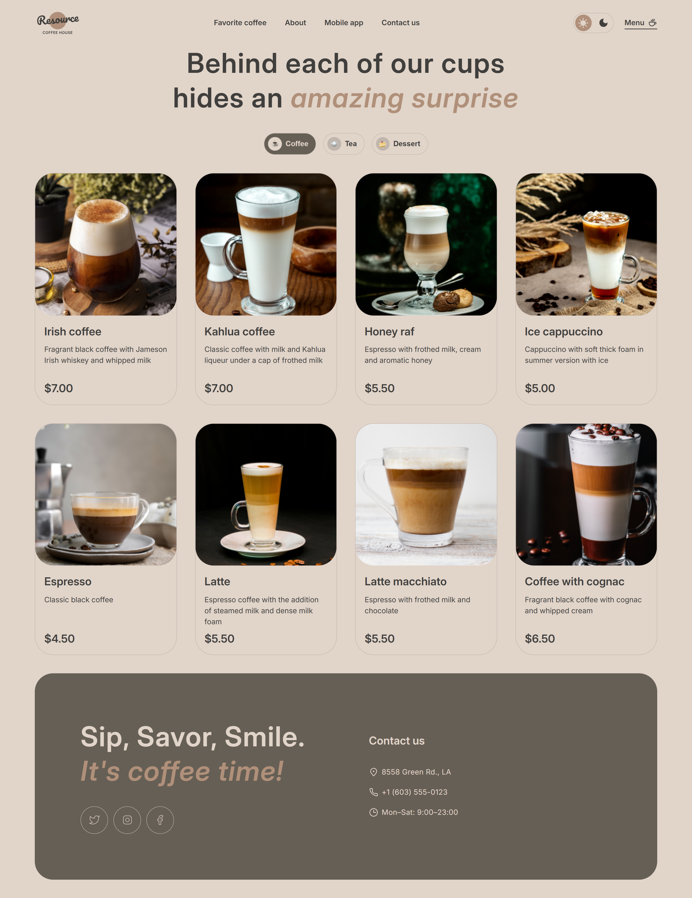

# Coffee House

A responsive multi-page website for the "Resource" coffee house. It features a landing page with a video hero and a favorite-coffee slider, plus a menu page with category filtering and a product modal where size and additives can be customized with a live total price.
The project is built using Vanilla JavaScript (ES Modules) without any frameworks.

---

## Screenshot

<table>
  <tr>
    <td></td>
    <td></td>
  </tr>
</table>

---

🔗 Live Demo: https://tatiana-golub.github.io/rsschool-landing-page/

---

## Features

- Hero section with a looping background video (poster image and reduced-motion fallback)
- "Favorite coffee" slider with arrows, pagination dots and swipe support
- Product cards rendered from a JSON file
- Category-based filtering
- "Load more" button (4 cards on small screens, 8 on wider ones)
- Modal window with product details, size and additives selection
- Live total price calculation inside the modal
- Light / dark theme switcher
- Responsive layout (mobile-first: 380px → 768px → 1440px)
- Burger menu for mobile and tablet devices
- Smooth hover effects on gallery images, menu cards and buttons

---

## Technologies Used

- HTML5
- CSS3 (BEM methodology, custom properties, mobile-first media queries)
- JavaScript (ES6+, ES Modules)
- Native `<dialog>` API
- Native `<video>` element
- SVG sprite with `currentColor` icons
- `matchMedia` for responsive behavior in JavaScript

---

## Architecture

The project follows modular architecture:

```
css/
  ├── base.css          
  ├── layout.css       
  ├── components.css    
  └── responsive.css    

data/
  └── products.json

js/
  ├── pages/
  │     ├── home.js
  │     └── menu.js
  ├── components/
  │     ├── burgerMenu.js
  │     ├── slider.js
  │     ├── menuCatalog.js
  │     └── productModal.js
  └── main.js

assets/
  ├── images/
  ├── icons/
  ├── svg/          
  ├── videos/
  └── screenshots/
```

---

## Installation & Setup

```bash
git clone https://github.com/Tatiana-Golub/rsschool-landing-page.git
cd rsschool-landing-page
```

Run the project using Live Server or any local development server.
